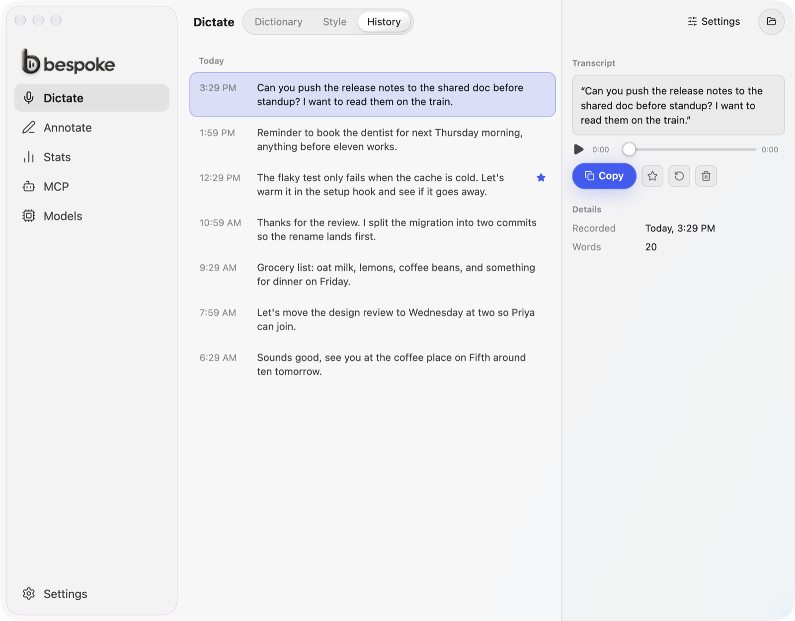

<p align="center">
  <picture>
    <source media="(prefers-color-scheme: dark)" srcset="assets/bespoke-logo-clay-dark.png">
    
  </picture>
</p>

Bespoke is a speech-to-text dictation app for macOS. It records while you hold or tap a shortcut, transcribes on your Mac with a local model, and pastes the text into the app in front. Audio never leaves your Mac. It is written in Rust with [GPUI](https://www.gpui.rs/), Zed's UI framework.

<picture>
  <source media="(prefers-color-scheme: dark)" srcset="docs/screenshots/history-dark.png">
  
</picture>

## Demo

https://github.com/user-attachments/assets/a4b411af-51da-4ade-a893-a0ed57915ded

## Install

Bespoke runs on macOS with Apple Silicon. Annotate needs macOS 26.

1. Download `Bespoke-<version>.zip` from the [latest release](https://github.com/andynaguyen/bespoke/releases/latest).
2. Open the zip and drag Bespoke to Applications.
3. Open Bespoke. macOS says it can't check the app for malicious software, because the app isn't notarized.
4. Open System Settings > Privacy & Security, scroll down, and click Open Anyway.

You only do this once. Bespoke checks for updates and installs them itself.

On first launch Bespoke asks for two permissions:

- **Microphone**, to record you.
- **Accessibility**, for the global shortcut and to paste into the app in front.

Then pick a transcription model. Bespoke downloads it from Hugging Face, and transcription runs offline after that. Annotate also asks for Screen Recording the first time you use it.

### Build from source

You need Rust, cmake (`brew install cmake`) and Xcode 26 or its Command Line Tools.

```bash
git clone https://github.com/andynaguyen/bespoke.git
cd bespoke
scripts/create-signing-identity.sh   # once per Mac
scripts/install-local.sh
```

`install-local.sh` builds a release, signs it with a self-signed identity in your login keychain, and installs it to `/Applications/Bespoke.app`. A stable signing identity keeps the Microphone and Accessibility grants when you reinstall. A local build doesn't update itself. Pull and run the script again to update.

## Use it

Hold `⌥Space` and talk, then let go. Bespoke transcribes what you said and pastes it into the app in front. Tap `⌥Space` instead to start recording, and tap it again to stop. Change the shortcut, or make it hold-only or tap-only, in Settings.

The Dictate page has three tabs:

- **Dictionary.** Words are names and terms Bespoke gets wrong. A replacement writes your text whenever you say a phrase, like your email address for "my email".
- **Style.** How much capitalization and punctuation each app gets. Apps without a rule get Formal.
- **History.** Each transcription, with its recording.

Post-processing is off by default. Turn it on to send each transcript, never the audio, to an OpenAI-compatible API with a prompt of your choice.

### Annotate

Annotate is [Scrawl](https://github.com/kitlangton/scrawl) inside Bespoke. It records a bug report for a coding agent: your screen, what you say, and what you draw on it.

- Tap `⌥⇧S` to record the screen under the pointer while you talk. Hold `⇧` and move the pointer to draw. Tap `⌥⇧S` again to finish.
- Hold `⌥⇧S` to pick an area, a window or the screen instead.
- `⌥⇧V` pastes the capture's contact sheet and `summary.md` into the app in front.

The Annotate page holds both shortcuts, the microphone, and how long Bespoke keeps captures. The MCP page turns on Agent Access, an MCP server that lets Claude Code and Codex read your captures, and shows the setup to copy.

### Command line

A second `bespoke` launch sends its flags to the running app, so you can bind these to other tools:

```bash
/Applications/Bespoke.app/Contents/MacOS/bespoke --toggle-transcription
/Applications/Bespoke.app/Contents/MacOS/bespoke --cancel
```

`--transcribe-file <WAV>` transcribes a 16 kHz mono WAV and exits. `--help` lists every flag.

## Data

Settings, history, recordings and Annotate captures live in `~/Library/Application Support/com.andynguyen.bespoke`, and logs in `~/Library/Logs/com.andynguyen.bespoke`. Delete those folders to reset Bespoke. Downloaded models go to the Hugging Face cache, `~/.cache/huggingface/hub`, which other tools that use Hugging Face models share.

## Known limitations

- **Platforms.** Only the macOS build has been compiled and run. The Windows and Linux code paths have never been compiled.
- **Screen readers.** GPUI exposes no accessibility tree, so screen readers get no labels. Keyboard use works: Tab moves through controls and stays inside open dialogs, Enter and Space activate, arrow keys move sliders and heatmap days, and Escape closes menus.
- **Linux windows.** GPUI cannot hide a window and ends the app when the last window closes. Closing the main window therefore minimizes it, and starting hidden starts minimized.
- **Overlay placement.** On Wayland the compositor places the overlay. On Windows the overlay is centered on the display under the cursor, without DPI or text-scale adjustments.
- **Overlay window lifetime.** The overlay window opens on each show and closes 300ms after hiding. Its pop-in fades without a scale effect, because GPUI cannot scale an element.
- **Right-to-left languages.** Rows, margins and the toggle knob mirror. Text inputs keep left-aligned text, the slider and the recording seek bar stay left to right, and long wrapped Arabic or Hebrew lines can clip at the left edge (GPUI's bidi line wrapping).
- **Shortcut recorder on Windows and Linux.** Key names come from the logical key, so numpad keys and non-US layouts can store different names than the physical key.
- **Signing.** Releases are signed with a self-signed identity and aren't notarized, so macOS asks you to approve the first launch.

## Contributing

Read [CONTRIBUTING.md](CONTRIBUTING.md) to set up a build, find your way around the code, and send a pull request.

## License

MIT. Bespoke started as a fork of [Handy](https://github.com/cjpais/Handy) by CJ Pais; see [LICENSE](LICENSE).
